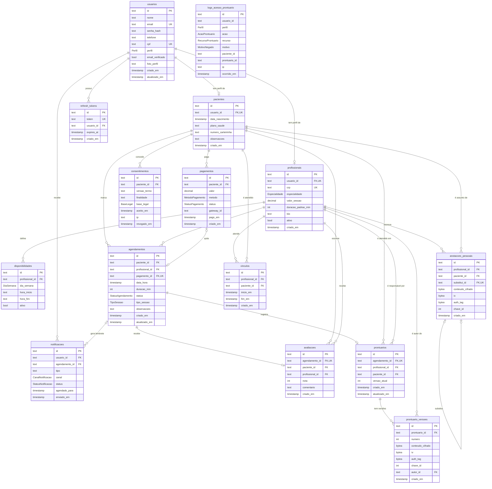

# Banco de dados do Agendô (Anexo A)

Documento gerado a partir de `backend/src/prisma/schema.prisma` e das três migrations em `backend/src/prisma/migrations/`:

| Migration | O que faz |
|---|---|
| `20260422115518_init` | Cria as tabelas de cadastro, agenda, pagamento, notificação, avaliação e o prontuário antigo (texto aberto). |
| `20261103120000_prontuario_cifrado_versionado` | Remove o texto aberto do prontuário, cria as versões cifradas, as anotações pessoais, o vínculo, o consentimento e o log de acesso. |
| `20261110120000_gatilhos_so_insercao` | Cria os gatilhos que impedem o banco de alterar ou apagar o histórico clínico, o log e o consentimento. |

Banco: PostgreSQL. Acesso pela aplicação: Prisma 5 (consultas sempre com parâmetros). Todos os dados de exemplo e de teste são fictícios.

---

## 1. Diagrama entidade-relacionamento

Os nomes são os das tabelas no banco. Leitura das pontas: `||` = exatamente um, `o|` = zero ou um, `o{` = zero ou muitos.

A tabela `logs_acesso_prontuario` aparece sozinha de propósito: ela não tem nenhuma chave estrangeira (ver a seção 4).

---

## 2. Dicionário de dados

**Como ler as tabelas abaixo**

- **Tipo**: o tipo da coluna no PostgreSQL. `timestamp(3)` é data e hora com milissegundos, **sem fuso horário**. `bytea` é uma sequência de bytes. `decimal(10,2)` é um número com 2 casas decimais. Os tipos com nome próprio (`Perfil`, `StatusAgendamento` etc.) são *enums*, ou seja, listas fechadas de valores (ver 2.16).
- **Obrigatório**: "Sim" quer dizer `NOT NULL` no banco (a coluna não pode ficar vazia).
- **Chave**: `PK` = chave primária (identifica a linha). `FK → tabela` = chave estrangeira (aponta para outra tabela). `UK` = valor único (não pode repetir).
- **Padrão**: os ids com "UUID gerado pelo Prisma" e as colunas `atualizado_em` são preenchidos pelo Prisma na aplicação, não pelo banco. As colunas com `CURRENT_TIMESTAMP`, `true`, `false` ou números fixos têm valor padrão no próprio banco.

### 2.1 `usuarios` (modelo `Usuario`)
Dados de login e cadastro, comuns a pacientes e profissionais.

| Campo | Tipo | Obrigatório | Chave | Descrição |
|---|---|---|---|---|
| id | text | Sim | PK | Identificador (UUID gerado pelo Prisma). |
| nome | text | Sim | | Nome da pessoa. |
| email | text | Sim | UK | E-mail de login. Não se repete. |
| senha_hash | text | Sim | | Resultado do bcrypt. A senha nunca é guardada. |
| telefone | text | Não | | Telefone de contato. |
| cpf | text | Sim | UK | CPF. Não se repete. |
| perfil | Perfil | Sim | | `PACIENTE` ou `PROFISSIONAL`. |
| email_verificado | boolean | Sim | | Se o e-mail foi confirmado. Padrão `false`. |
| foto_perfil | text | Não | | Referência à foto de perfil. |
| criado_em | timestamp(3) | Sim | | Data de cadastro. Padrão `CURRENT_TIMESTAMP`. |
| atualizado_em | timestamp(3) | Sim | | Última alteração (preenchida pelo Prisma). |

### 2.2 `refresh_tokens` (modelo `RefreshToken`)
Tokens que renovam a sessão sem pedir a senha de novo.

| Campo | Tipo | Obrigatório | Chave | Descrição |
|---|---|---|---|---|
| id | text | Sim | PK | Identificador (UUID gerado pelo Prisma). |
| token | text | Sim | UK | O token de renovação. |
| usuario_id | text | Sim | FK → usuarios | Dono do token. |
| expires_at | timestamp(3) | Sim | | Quando o token deixa de valer. |
| criado_em | timestamp(3) | Sim | | Data de criação. Padrão `CURRENT_TIMESTAMP`. |

### 2.3 `pacientes` (modelo `Paciente`)
Dados cadastrais do paciente. **Não guarda conteúdo clínico** (esse fica em `prontuario_versoes`).

| Campo | Tipo | Obrigatório | Chave | Descrição |
|---|---|---|---|---|
| id | text | Sim | PK | Identificador (UUID gerado pelo Prisma). |
| usuario_id | text | Sim | FK → usuarios, UK | Usuário dono deste perfil. Único: um usuário tem no máximo um perfil de paciente. |
| data_nascimento | timestamp(3) | Não | | Data de nascimento. |
| plano_saude | text | Não | | Nome do plano de saúde. |
| numero_carteirinha | text | Não | | Número da carteirinha do plano. |
| observacoes | text | Não | | Observações cadastrais, em texto aberto (ver limite 6.2, item 8). |
| criado_em | timestamp(3) | Sim | | Data de cadastro. Padrão `CURRENT_TIMESTAMP`. |

### 2.4 `profissionais` (modelo `Profissional`)
Dados do psicólogo.

| Campo | Tipo | Obrigatório | Chave | Descrição |
|---|---|---|---|---|
| id | text | Sim | PK | Identificador (UUID gerado pelo Prisma). |
| usuario_id | text | Sim | FK → usuarios, UK | Usuário dono deste perfil. Único. |
| crp | text | Sim | UK | Registro no Conselho Regional de Psicologia. Não se repete. |
| especialidade | Especialidade | Sim | | Área de atuação. |
| valor_sessao | decimal(10,2) | Sim | | Valor cobrado por sessão. |
| duracao_padrao_min | integer | Sim | | Duração padrão da sessão em minutos. Padrão `50`. |
| bio | text | Não | | Apresentação pública. |
| ativo | boolean | Sim | | Se aparece para agendamento. Padrão `true`. |
| criado_em | timestamp(3) | Sim | | Data de cadastro. Padrão `CURRENT_TIMESTAMP`. |

### 2.5 `disponibilidades` (modelo `Disponibilidade`)
Faixas de horário semanais em que o profissional atende.

| Campo | Tipo | Obrigatório | Chave | Descrição |
|---|---|---|---|---|
| id | text | Sim | PK | Identificador (UUID gerado pelo Prisma). |
| profissional_id | text | Sim | FK → profissionais | Profissional da faixa. |
| dia_semana | DiaSemana | Sim | | Dia da semana. |
| hora_inicio | text | Sim | | Início, no formato "08:00". |
| hora_fim | text | Sim | | Fim, no formato "18:00". |
| ativo | boolean | Sim | | Se a faixa está valendo. Padrão `true`. |

### 2.6 `agendamentos` (modelo `Agendamento`)
Cada consulta marcada.

| Campo | Tipo | Obrigatório | Chave | Descrição |
|---|---|---|---|---|
| id | text | Sim | PK | Identificador (UUID gerado pelo Prisma). |
| paciente_id | text | Sim | FK → pacientes | Paciente da consulta. |
| profissional_id | text | Sim | FK → profissionais | Profissional da consulta. |
| pagamento_id | text | Não | FK → pagamentos, UK | Pagamento ligado à consulta. Único: um pagamento quita no máximo uma consulta. |
| data_hora | timestamp(3) | Sim | | Data e hora da consulta. |
| duracao_min | integer | Sim | | Duração em minutos. Padrão `50`. |
| status | StatusAgendamento | Sim | | Situação da consulta. Padrão `PENDENTE`. |
| tipo_sessao | TipoSessao | Sim | | Tipo da sessão. |
| observacoes | text | Não | | Observação enviada no agendamento, em texto aberto (ver limite 6.2, item 8). |
| criado_em | timestamp(3) | Sim | | Data de criação. Padrão `CURRENT_TIMESTAMP`. |
| atualizado_em | timestamp(3) | Sim | | Última alteração (preenchida pelo Prisma). |

### 2.7 `pagamentos` (modelo `Pagamento`)
Pagamentos das consultas. Hoje são **simulados** (sem gateway real).

| Campo | Tipo | Obrigatório | Chave | Descrição |
|---|---|---|---|---|
| id | text | Sim | PK | Identificador (UUID gerado pelo Prisma). |
| paciente_id | text | Sim | FK → pacientes | Quem pagou. |
| valor | decimal(10,2) | Sim | | Valor pago. |
| metodo | MetodoPagamento | Sim | | Forma de pagamento. |
| status | StatusPagamento | Sim | | Situação. Padrão `PENDENTE`. |
| gateway_id | text | Não | | Identificador da transação no serviço de pagamento. |
| pago_em | timestamp(3) | Não | | Quando foi aprovado. |
| criado_em | timestamp(3) | Sim | | Data de criação. Padrão `CURRENT_TIMESTAMP`. |

### 2.8 `notificacoes` (modelo `Notificacao`)
Lembretes de consulta. Hoje o envio é **simulado**.

| Campo | Tipo | Obrigatório | Chave | Descrição |
|---|---|---|---|---|
| id | text | Sim | PK | Identificador (UUID gerado pelo Prisma). |
| usuario_id | text | Sim | FK → usuarios | Quem recebe. |
| agendamento_id | text | Não | FK → agendamentos | Consulta a que o lembrete se refere. |
| tipo | text | Sim | | Momento do lembrete, por exemplo `3_DIAS_ANTES`, `1_DIA_ANTES`, `2_HORAS_ANTES`. |
| canal | CanalNotificacao | Sim | | E-mail, SMS ou push. |
| status | StatusNotificacao | Sim | | Situação do envio. Padrão `AGENDADA`. |
| agendado_para | timestamp(3) | Sim | | Quando deve ser enviado. |
| enviado_em | timestamp(3) | Não | | Quando foi enviado. |

### 2.9 `avaliacoes` (modelo `Avaliacao`)
Nota que o paciente dá depois da consulta.

| Campo | Tipo | Obrigatório | Chave | Descrição |
|---|---|---|---|---|
| id | text | Sim | PK | Identificador (UUID gerado pelo Prisma). |
| agendamento_id | text | Sim | FK → agendamentos, UK | Consulta avaliada. Único: uma avaliação por consulta. |
| paciente_id | text | Sim | FK → pacientes | Quem avaliou. |
| profissional_id | text | Sim | FK → profissionais | Quem foi avaliado. |
| nota | integer | Sim | | Nota de 1 a 5 (a faixa ainda não é verificada pelo banco). |
| comentario | text | Não | | Comentário livre. |
| criado_em | timestamp(3) | Sim | | Data da avaliação. Padrão `CURRENT_TIMESTAMP`. |

### 2.10 `prontuarios` (modelo `Prontuario`)
O "ponteiro" do prontuário: só ids e o número da versão atual. **Nenhum texto clínico.**

| Campo | Tipo | Obrigatório | Chave | Descrição |
|---|---|---|---|---|
| id | text | Sim | PK | Identificador. Gerado no código (`crypto.randomUUID`) antes do INSERT, porque entra no AAD da cifragem. |
| agendamento_id | text | Sim | FK → agendamentos, UK | Consulta registrada. Único: um prontuário por consulta. |
| profissional_id | text | Sim | FK → profissionais | Profissional responsável. |
| paciente_id | text | Sim | FK → pacientes | Paciente. |
| versao_atual | integer | Sim | | Número da versão vigente em `prontuario_versoes`. Só pode avançar de 1 em 1 (gatilho). |
| criado_em | timestamp(3) | Sim | | Data de criação. Padrão `CURRENT_TIMESTAMP`. |
| atualizado_em | timestamp(3) | Sim | | Última troca de versão (preenchida pelo Prisma). |

### 2.11 `prontuario_versoes` (modelo `ProntuarioVersao`)
O conteúdo clínico, **cifrado com AES-256-GCM**. Uma linha por versão; nunca é alterada.

| Campo | Tipo | Obrigatório | Chave | Descrição |
|---|---|---|---|---|
| id | text | Sim | PK | Identificador (UUID gerado pelo Prisma). |
| prontuario_id | text | Sim | FK → prontuarios | Prontuário a que a versão pertence. |
| numero | integer | Sim | UK (com prontuario_id) | Número da versão: 1, 2, 3... Não se repete dentro do mesmo prontuário. |
| conteudo_cifrado | bytea | Sim | | JSON `{ v, anotacoes, cid, lembretes }` cifrado. |
| iv | bytea | Sim | | Vetor de inicialização: 12 bytes aleatórios, novo a cada versão. |
| auth_tag | bytea | Sim | | Lacre de 16 bytes do GCM: se o bloco for alterado, a decifragem falha. |
| chave_id | integer | Sim | | Qual chave cifrou o bloco (permite trocar de chave no futuro). Padrão `1`. |
| autor_id | text | Sim | FK → profissionais | Profissional que escreveu esta versão. |
| criado_em | timestamp(3) | Sim | | Quando a versão foi gravada. Padrão `CURRENT_TIMESTAMP`. |

O AAD ("dados autenticados adicionais") é `agendo|prontuario|v1|<id do prontuário>|<número da versão>`. Ele não fica gravado, mas entra no lacre: um bloco copiado para outra linha não decifra. A chave vem só da variável de ambiente `PRONTUARIO_KEY`.

### 2.12 `anotacoes_pessoais` (modelo `AnotacaoPessoal`)
Anotações do psicólogo para uso próprio, **cifradas** e **nunca exibidas ao paciente**.

| Campo | Tipo | Obrigatório | Chave | Descrição |
|---|---|---|---|---|
| id | text | Sim | PK | Identificador. Gerado no código, porque entra no AAD (`agendo|anotacao|v1|<id>`). |
| profissional_id | text | Sim | FK → profissionais | Autor da anotação. |
| paciente_id | text | Sim | FK → pacientes | Paciente a que se refere. |
| substitui_id | text | Não | FK → anotacoes_pessoais, UK | Anotação que esta substitui ("editar" cria uma linha nova). Único: cada anotação só pode ser substituída uma vez. |
| conteudo_cifrado | bytea | Sim | | Texto cifrado. |
| iv | bytea | Sim | | 12 bytes aleatórios, novos a cada linha. |
| auth_tag | bytea | Sim | | Lacre de 16 bytes. |
| chave_id | integer | Sim | | Qual chave cifrou. Padrão `1`. |
| criado_em | timestamp(3) | Sim | | Data de criação. Padrão `CURRENT_TIMESTAMP`. |

### 2.13 `vinculos` (modelo `Vinculo`)
Relação de atendimento entre um profissional e um paciente. Nasce quando o profissional confirma a primeira consulta. Está **ativo** quando `inicio_em` já passou e `fim_em` está vazio ou no futuro.

| Campo | Tipo | Obrigatório | Chave | Descrição |
|---|---|---|---|---|
| id | text | Sim | PK | Identificador (UUID gerado pelo Prisma). |
| profissional_id | text | Sim | FK → profissionais | Profissional. |
| paciente_id | text | Sim | FK → pacientes | Paciente. |
| inicio_em | timestamp(3) | Sim | | Início do vínculo. Padrão `CURRENT_TIMESTAMP`. |
| fim_em | timestamp(3) | Não | | Fim do vínculo. Vazio = sem data de término. |
| criado_em | timestamp(3) | Sim | | Data de criação. Padrão `CURRENT_TIMESTAMP`. |

### 2.14 `consentimentos` (modelo `Consentimento`)
Registro do consentimento do paciente (LGPD, art. 7º e 11). É por paciente, não por profissional. `finalidade` e `base_legal` vêm da configuração do servidor, nunca do navegador.

| Campo | Tipo | Obrigatório | Chave | Descrição |
|---|---|---|---|---|
| id | text | Sim | PK | Identificador (UUID gerado pelo Prisma). |
| paciente_id | text | Sim | FK → pacientes | Titular dos dados. |
| versao_termo | text | Sim | | Versão do termo que o paciente aceitou. |
| finalidade | text | Sim | | Para que os dados serão usados. |
| base_legal | BaseLegal | Sim | | Base legal do tratamento (valores a confirmar com o professor). |
| aceito_em | timestamp(3) | Sim | | Quando aceitou. Padrão `CURRENT_TIMESTAMP`. |
| ip | text | Sim | | IP de onde veio o aceite. |
| revogado_em | timestamp(3) | Não | | Quando revogou. Vazio = consentimento válido. Só pode ser preenchido uma vez (gatilho). |

### 2.15 `logs_acesso_prontuario` (modelo `LogAcessoProntuario`)
Registro de cada leitura, criação, edição ou tentativa negada (LGPD, art. 37). **Sem conteúdo clínico e sem chaves estrangeiras.**

| Campo | Tipo | Obrigatório | Chave | Descrição |
|---|---|---|---|---|
| id | text | Sim | PK | Identificador (UUID gerado pelo Prisma). |
| usuario_id | text | Sim | | Quem tentou o acesso (id de `usuarios`, sem chave estrangeira). |
| perfil | Perfil | Sim | | Perfil de quem tentou. |
| acao | AcaoProntuario | Sim | | `LEITURA`, `CRIACAO`, `EDICAO` ou `NEGADO`. |
| recurso | RecursoProntuario | Sim | | Prontuário ou anotação pessoal. |
| motivo | MotivoNegado | Não | | Por que foi negado. Preenchido só quando `acao = NEGADO`. Fica só no log, nunca vai para o cliente. |
| paciente_id | text | Não | | Paciente envolvido, quando se sabe (sem chave estrangeira). |
| prontuario_id | text | Não | | Prontuário envolvido, quando se sabe (sem chave estrangeira). |
| ip | text | Não | | IP de origem. |
| ocorrido_em | timestamp(3) | Sim | | Quando aconteceu. Padrão `CURRENT_TIMESTAMP`. |

### 2.16 Enums (listas fechadas de valores)

| Enum | Valores | Usado em |
|---|---|---|
| Perfil | PACIENTE, PROFISSIONAL | usuarios.perfil, logs_acesso_prontuario.perfil |
| Especialidade | PSICOLOGIA_CLINICA, PSIQUIATRIA, TCC, PSICANALISE, FAMILIAR, INFANTIL | profissionais.especialidade |
| DiaSemana | DOMINGO, SEGUNDA, TERCA, QUARTA, QUINTA, SEXTA, SABADO | disponibilidades.dia_semana |
| StatusAgendamento | PENDENTE, CONFIRMADO, REALIZADO, CANCELADO, REMARCADO | agendamentos.status |
| TipoSessao | AVALIACAO_INICIAL, ACOMPANHAMENTO, TCC, PSICANALISE | agendamentos.tipo_sessao |
| StatusPagamento | PENDENTE, APROVADO, RECUSADO, ESTORNADO | pagamentos.status |
| MetodoPagamento | CARTAO_CREDITO, CARTAO_DEBITO, PIX, CONVENIO | pagamentos.metodo |
| CanalNotificacao | EMAIL, SMS, PUSH | notificacoes.canal |
| StatusNotificacao | AGENDADA, ENVIADA, FALHOU | notificacoes.status |
| AcaoProntuario | LEITURA, CRIACAO, EDICAO, NEGADO | logs_acesso_prontuario.acao |
| RecursoProntuario | PRONTUARIO, ANOTACAO_PESSOAL | logs_acesso_prontuario.recurso |
| MotivoNegado | PERFIL_NAO_PERMITIDO, ENTRADA_INVALIDA, SEM_VINCULO, SEM_CONSENTIMENTO, NAO_ENCONTRADO, VERSAO_DESATUALIZADA, FALHA_INTEGRIDADE | logs_acesso_prontuario.motivo |
| BaseLegal | CONSENTIMENTO, TUTELA_SAUDE | consentimentos.base_legal |

---

## 3. Regras de integridade

### 3.1 Chaves estrangeiras e o que acontece ao apagar (ON DELETE)

O que cada regra quer dizer:

- **CASCADE**: apagar a linha "mãe" apaga junto as linhas "filhas".
- **RESTRICT**: o banco recusa apagar a linha "mãe" enquanto existir alguma "filha" apontando para ela.
- **SET NULL**: apagar a "mãe" deixa a coluna da "filha" vazia (só serve para colunas opcionais).

Todas as chaves estrangeiras também têm `ON UPDATE CASCADE` (se o id da mãe mudar, a filha acompanha). Na prática isso não acontece, porque os ids são UUIDs que nunca mudam.

| Tabela (coluna) | Aponta para | ON DELETE | Efeito |
|---|---|---|---|
| refresh_tokens (usuario_id) | usuarios | CASCADE | Apagar o usuário apaga os tokens dele. |
| pacientes (usuario_id) | usuarios | CASCADE | Apagar o usuário tenta apagar o perfil de paciente. |
| profissionais (usuario_id) | usuarios | CASCADE | Apagar o usuário tenta apagar o perfil de profissional. |
| disponibilidades (profissional_id) | profissionais | CASCADE | Apagar o profissional apaga os horários dele. |
| notificacoes (usuario_id) | usuarios | RESTRICT | Usuário com notificação não pode ser apagado. |
| notificacoes (agendamento_id) | agendamentos | SET NULL | Apagar a consulta deixa a notificação sem consulta. |
| agendamentos (paciente_id) | pacientes | RESTRICT | Paciente com consulta não pode ser apagado. |
| agendamentos (profissional_id) | profissionais | RESTRICT | Profissional com consulta não pode ser apagado. |
| agendamentos (pagamento_id) | pagamentos | SET NULL | Apagar o pagamento deixa a consulta sem pagamento. |
| pagamentos (paciente_id) | pacientes | RESTRICT | Paciente com pagamento não pode ser apagado. |
| avaliacoes (agendamento_id) | agendamentos | RESTRICT | Consulta avaliada não pode ser apagada. |
| avaliacoes (paciente_id) | pacientes | RESTRICT | Paciente que avaliou não pode ser apagado. |
| avaliacoes (profissional_id) | profissionais | RESTRICT | Profissional avaliado não pode ser apagado. |
| prontuarios (agendamento_id) | agendamentos | RESTRICT | Consulta com prontuário não pode ser apagada. |
| prontuarios (profissional_id) | profissionais | RESTRICT | Profissional com prontuário não pode ser apagado. |
| prontuarios (paciente_id) | pacientes | RESTRICT | Paciente com prontuário não pode ser apagado. |
| prontuario_versoes (prontuario_id) | prontuarios | RESTRICT | Prontuário com versões não pode ser apagado. |
| prontuario_versoes (autor_id) | profissionais | RESTRICT | Autor de versão não pode ser apagado. |
| anotacoes_pessoais (profissional_id) | profissionais | RESTRICT | Profissional com anotação não pode ser apagado. |
| anotacoes_pessoais (paciente_id) | pacientes | RESTRICT | Paciente com anotação não pode ser apagado. |
| anotacoes_pessoais (substitui_id) | anotacoes_pessoais | RESTRICT | Anotação já substituída não pode ser apagada. |
| vinculos (profissional_id) | profissionais | RESTRICT | Profissional com vínculo não pode ser apagado. |
| vinculos (paciente_id) | pacientes | RESTRICT | Paciente com vínculo não pode ser apagado. |
| consentimentos (paciente_id) | pacientes | RESTRICT | Paciente com consentimento não pode ser apagado. |

**Como as regras se combinam.** Apagar um usuário dispara o CASCADE para `pacientes` ou `profissionais`. Mas, se esse perfil tiver qualquer consulta, prontuário, vínculo, consentimento ou anotação, o RESTRICT dessas tabelas barra a operação, e o comando inteiro é desfeito. Resultado: **quem tem histórico clínico não pode ser apagado fisicamente**. É o que a regra de retenção pede (guarda mínima de 5 anos pelo CFP; o projeto adota 20 anos, a referência da Lei 13.787/2018, até confirmação do grupo).

Todas as tabelas novas do prontuário usam RESTRICT, nunca CASCADE: nenhuma exclusão em outro lugar pode levar junto um registro clínico.

### 3.2 Índices únicos

Um índice único impede que um valor (ou uma combinação de valores) se repita. No PostgreSQL, valores vazios (NULL) não contam como repetição, então várias linhas podem ter a coluna vazia.

| Índice | Coluna(s) | O que garante |
|---|---|---|
| usuarios_email_key | usuarios(email) | Um cadastro por e-mail. |
| usuarios_cpf_key | usuarios(cpf) | Um cadastro por CPF. |
| refresh_tokens_token_key | refresh_tokens(token) | Token não se repete. |
| pacientes_usuario_id_key | pacientes(usuario_id) | Um usuário tem no máximo um perfil de paciente (relação 1 para 1). |
| profissionais_usuario_id_key | profissionais(usuario_id) | Um usuário tem no máximo um perfil de profissional. |
| profissionais_crp_key | profissionais(crp) | O mesmo CRP não aparece duas vezes. |
| agendamentos_pagamento_id_key | agendamentos(pagamento_id) | Um pagamento quita no máximo uma consulta. |
| avaliacoes_agendamento_id_key | avaliacoes(agendamento_id) | Uma avaliação por consulta. |
| prontuarios_agendamento_id_key | prontuarios(agendamento_id) | Um prontuário por consulta. |
| prontuario_versoes_prontuario_id_numero_key | prontuario_versoes(prontuario_id, numero) | Não existem duas "versão 2" do mesmo prontuário. Também impede que duas edições ao mesmo tempo gravem o mesmo número. |
| anotacoes_pessoais_substitui_id_key | anotacoes_pessoais(substitui_id) | Cada anotação é substituída no máximo uma vez, então o histórico é uma fila reta, sem bifurcação. |

Índices comuns (só aceleram buscas, não proíbem repetição): `prontuarios(paciente_id, profissional_id)`, `anotacoes_pessoais(profissional_id, paciente_id)`, `vinculos(profissional_id, paciente_id)`, `consentimentos(paciente_id, aceito_em)`, `logs_acesso_prontuario(paciente_id, ocorrido_em)` e `logs_acesso_prontuario(usuario_id, ocorrido_em)`. Eles servem às perguntas que o sistema mais faz: "este profissional tem vínculo com este paciente?", "qual o consentimento mais recente?", "quem acessou os dados deste paciente?".

### 3.3 Gatilhos (migration `20261110120000_gatilhos_so_insercao`)

Um **gatilho** (*trigger*) é uma função que o próprio PostgreSQL executa antes de um comando. Se a função gera um erro, o comando é recusado. A vantagem é que a regra vale para qualquer programa que conecte no banco, e não só para o código do Agendô.

As mensagens de erro têm só o nome da tabela e da operação (por exemplo `SO_INSERCAO: DELETE não é permitido em prontuario_versoes`). Nenhum dado do registro aparece na mensagem.

| Tabela | Recusa | Permite |
|---|---|---|
| prontuario_versoes | UPDATE, DELETE, TRUNCATE | Só INSERT. |
| anotacoes_pessoais | UPDATE, DELETE, TRUNCATE | Só INSERT ("editar" é inserir uma linha nova com `substitui_id`). |
| logs_acesso_prontuario | UPDATE, DELETE, TRUNCATE | Só INSERT. |
| consentimentos | DELETE, TRUNCATE e qualquer UPDATE fora da revogação | INSERT e um único UPDATE: preencher `revogado_em`. |
| prontuarios | DELETE, TRUNCATE e qualquer UPDATE fora do avanço de versão | INSERT e UPDATE que só aumenta `versao_atual` em 1 (com `atualizado_em`). |

Como cada gatilho funciona:

1. **`recusar_alteracao_so_insercao`** (nas três primeiras tabelas). Recusa sempre. Roda "por comando" (`FOR EACH STATEMENT`): basta o comando UPDATE ou DELETE chegar à tabela para ser recusado, mesmo que não atinja nenhuma linha. É por comando porque o TRUNCATE (apagar a tabela inteira de uma vez) só aceita esse tipo de gatilho.
2. **`consentimento_so_revogacao`** (em `consentimentos`). Roda "por linha" (`FOR EACH ROW`), porque precisa comparar a linha antes (`OLD`) e depois (`NEW`) da mudança. Recusa quando:
   - o consentimento já estava revogado (não se revoga duas vezes nem se "desrevoga");
   - a nova data de revogação está vazia;
   - a data de revogação é anterior à data do aceite;
   - qualquer outra coluna mudou junto. A comparação é feita com a linha inteira convertida em JSON, menos `revogado_em`. Assim, uma coluna criada no futuro já nasce protegida, sem precisar mexer no gatilho.

   Um gatilho separado, por comando, recusa o TRUNCATE.
3. **`prontuario_so_avanca_versao`** (em `prontuarios`). Também por linha. Recusa o DELETE e recusa o UPDATE quando muda qualquer coluna além de `versao_atual` e `atualizado_em`, ou quando `versao_atual` não é exatamente a anterior + 1 (não volta e não pula). Um gatilho separado recusa o TRUNCATE.

Esses comportamentos têm teste automático em `backend/test/gatilhos.test.js`. Cada teste roda dentro de uma transação que é sempre desfeita no final, então nada fica gravado no banco de teste.

---

## 4. Por que o log não tem chave estrangeira e por que o prontuário é versionado

**Log sem chave estrangeira.** O log de acesso é a prova de quem viu ou tentou ver um prontuário (LGPD, art. 37), então ele precisa sobreviver a qualquer outro registro. Com chave estrangeira, as três regras possíveis atrapalham: com CASCADE, apagar um usuário apagaria junto o rastro do que ele fez; com RESTRICT, o log impediria para sempre a eliminação de registros que já cumpriram o prazo de guarda; com SET NULL, o banco tentaria apagar o "quem" do log, e o gatilho de só inserção recusaria. Além disso, o log também registra tentativas negadas com ids que não existem (motivos `NAO_ENCONTRADO` e `ENTRADA_INVALIDA`). Uma chave estrangeira recusaria justamente o registro dessas tentativas, que são as mais importantes para detectar abuso. O custo dessa escolha é que o banco não confere se os ids do log existem: quem garante isso é o código que grava o log.

**Prontuário versionado.** O prontuário é documento do atendimento e precisa ser guardado com o histórico (Res. CFP 001/2009; regra 3 do projeto: nunca sobrescrever). Por isso ele ficou dividido em duas tabelas: `prontuarios` guarda só o ponteiro (qual é a versão atual) e `prontuario_versoes` guarda cada versão cifrada, sem nunca alterar uma linha. Editar é inserir a versão `numero + 1` e avançar o ponteiro, na mesma transação (a rota de edição ainda será feita, na Tarefa 10; o banco já está pronto para ela). Assim é possível mostrar o que estava escrito em qualquer data, e nenhuma edição apaga a anterior. O AAD da cifragem inclui o id do prontuário e o número da versão, então trocar o conteúdo de uma versão pelo de outra faz a decifragem falhar.

### Sobre a normalização

As tabelas estão, em geral, na terceira forma normal: cada fato fica em um lugar só. `usuarios` guarda o que é comum a todos (login e contato), e `pacientes` e `profissionais` guardam o que é específico de cada perfil (generalização e especialização, ligadas por relação 1 para 1). O conteúdo clínico fica em tabelas separadas dos dados cadastrais, como manda a regra 2 do projeto. Há uma redundância proposital: `prontuarios` e `avaliacoes` repetem `paciente_id` e `profissional_id`, que daria para descobrir pela consulta (`agendamento_id`). Essa cópia deixa as checagens de acesso mais simples e rápidas, mas o banco ainda não garante que ela esteja de acordo com a consulta (ver 6.2, item 3).

---

## 5. Ordem das migrations (o que mudou no prontuário)

Na `init`, a tabela `prontuarios` tinha as colunas `anotacoes`, `cid` e `lembretes` em **texto aberto**. A migration `20261103120000` apagou essas três colunas e criou `versao_atual`; o conteúdo passou a morar cifrado em `prontuario_versoes`. Como os dados do projeto são todos fictícios, não houve migração de conteúdo antigo.

---

## 6. Limites conhecidos

### 6.1 Registrado na Tarefa 4 (comentário da migration `20261110120000`)

- **O dono da tabela ou um superusuário consegue desligar os gatilhos** (por exemplo com `ALTER TABLE ... DISABLE TRIGGER`) e, depois disso, alterar ou apagar o histórico. Gatilho protege contra erro de programa e contra quem só tem acesso de aplicação, não contra o administrador do banco. A proteção planejada é a **B7**: a aplicação passa a conectar com um usuário `agendo_app` que não é dono das tabelas e não tem UPDATE nem DELETE nas tabelas de só inserção. As migrations continuam com o usuário administrador. Enquanto a B7 não for feita, a proteção depende de qual usuário a aplicação usa para conectar (essa informação fica no `.env` e não foi conferida aqui).

### 6.2 Observados ao ler o schema e as migrations (o banco ainda não garante)

Estes pontos não estão no comentário da Tarefa 4. Hoje dependem do código da aplicação; alguns já estão planejados.

1. **Ponteiro e versão podem ficar desencontrados.** O gatilho garante que `versao_atual` avança de 1 em 1, mas não confere se existe a linha em `prontuario_versoes` com esse número. Um prontuário pode até ser criado sem nenhuma versão (o teste de gatilhos faz isso de propósito). O código precisa gravar as duas coisas na mesma transação.
2. **O autor da versão não precisa ser o profissional do prontuário.** `prontuario_versoes.autor_id` não é comparado com `prontuarios.profissional_id`.
3. **Paciente e profissional copiados podem divergir da consulta.** Em `prontuarios` e `avaliacoes`, nada impede que `paciente_id` e `profissional_id` sejam diferentes dos da consulta apontada.
4. **`motivo` só quando `NEGADO`:** a regra está no comentário do schema, sem regra CHECK no banco.
5. **Faixas de valores ainda sem CHECK** (planejado na B3): nota de 1 a 5, `duracao_min > 0`, `valor >= 0`, `fim_em > inicio_em` no vínculo.
6. **Duplicidades ainda possíveis:** dois agendamentos ativos no mesmo horário do mesmo profissional (B3), dois vínculos ativos para o mesmo par profissional e paciente (B5), dois consentimentos válidos ao mesmo tempo para o mesmo paciente.
7. **Datas sem fuso horário** (`timestamp(3)`): a mudança para `timestamptz` (UTC no banco) está planejada na B4.
8. **Texto aberto que pode receber dado de saúde.** `agendamentos.observacoes` (preenchido pelo paciente ao agendar) e `pacientes.observacoes` não são cifrados. Se alguém escrever ali algo clínico, esse dado sensível fica fora da proteção do prontuário. Sugestão para o grupo: deixar claro na tela que o campo não é para informação clínica, ou limitar o que ele aceita.
9. **`refresh_tokens.token` em texto aberto:** quem lê o banco consegue reaproveitar um token válido. O hash do token está planejado para a Sprint 2.
10. **Eliminação depois do prazo de guarda.** Os gatilhos recusam qualquer exclusão, sem olhar a idade do registro. Quando o prazo de retenção (`RETENCAO_PRONTUARIO_ANOS`) vencer, não há caminho pronto para eliminar os dados (LGPD, art. 16 e 18). Isso exigirá um procedimento de administrador documentado. **Ponto a decidir pelo grupo, com orientação do professor ou jurídica**; o documento não decide a questão legal.
